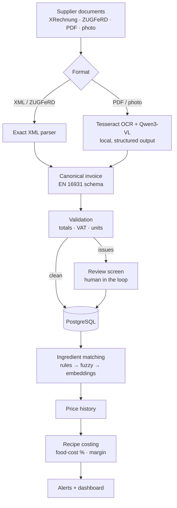
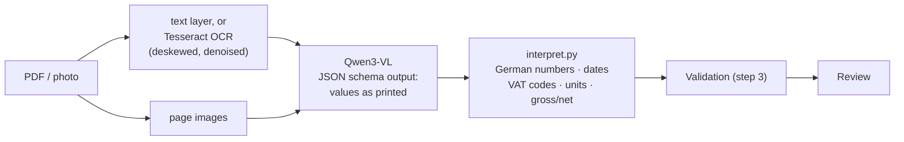

# Wareneinsatz-Pilot

[](https://github.com/Anant2580/wareneinsatz-pilot/actions/workflows/ci.yml)


**A food-cost copilot for restaurants.** It reads supplier invoices (XRechnung and ZUGFeRD e-invoices, PDFs and phone photos of paper receipts), turns them into ingredient prices and shows what each dish really costs, and which dishes lose margin when prices go up.

> 🚧 **Work in progress.** Steps 1–7 of 9 are done: XRechnung and ZUGFeRD invoices are read exactly, checked against business rules and approved or sent to review; PDFs and phone photos are read by OCR and a local, open-source vision language model; invoice lines are matched to ingredients, a price history per kg, litre or piece builds up, and every dish is costed with alerts for price jumps. See the [roadmap](#roadmap).

## Why

Small restaurants work out their food cost (*Wareneinsatz*) by hand, if at all: supplier invoices are typed into Excel or just filed away. Since January 2022, food, drinks, energy and staff have become more than 30 % more expensive in some cases, while menu prices rose 29.3 % ([DEHOGA Zahlenspiegel I/2026](https://www.dehoga-sachsen.de/fileadmin/user_upload/dehoga/Mitgliederbereich/DEHOGA-Zahlenspiegel_1._Quartal_2026.pdf)). A price jump on beef or frying oil quietly eats the margin of a dish.

E-invoices make part of this machine-readable: every German business has had to be able to receive XRechnung/ZUGFeRD since 2025, and sending them becomes mandatory in 2027 and 2028 ([IHK Magdeburg](https://www.ihk.de/magdeburg/recht/allgemeine-rechtsauskuenfte-1/steuerrecht/e-rechnung-6318984)). Invoices under €250 stay exempt, though, so cash & carry receipts and small suppliers will keep arriving on paper, as PDFs or as photos for years. A useful tool has to handle both.

## How it will work



## Roadmap

- [x] **Step 1 – Foundation:** canonical invoice schema (pydantic, EN 16931 field names), PostgreSQL schema with Alembic migrations, duplicate detection, tests against a real PostgreSQL, CI
- [x] **Step 2 – E-invoices:** XRechnung (UBL and CII) and ZUGFeRD/Factur-X PDFs read exactly, tested on the official KoSIT test invoices; command `wareneinsatz ingest`
- [x] **Step 3 – Validation:** totals, VAT, units, dates and supplier tax IDs checked; clean e-invoices approved automatically, the rest goes to review (`wareneinsatz review`)
- [x] **Step 4 – Evaluation set:** 82 labelled documents (synthetic invoices and receipts, phone-photo versions, official KoSIT invoices), field-level precision/recall/F1, rule-based baseline
- [x] **Step 5 – PDFs and photos:** OCR + a local vision language model (Qwen3-VL 8B) into the same schema: F1 98.9 % on the 82-document evaluation set, 67 documents completely correct
- [x] **Step 6 – Ingredient matching and price history:** memory of confirmed supplier products, fuzzy + embedding suggestions (93.9 % top-1 on held-out supplier texts), pack sizes from descriptions, net price per kg / l / piece
- [x] **Step 7 – Recipe costing and alerts:** dish cost with preparations and waste, food-cost %, gross margin, alerts for price jumps, cheaper suppliers and dishes over target, monthly Wareneinsatz
- [ ] **Step 8 – API and UI:** FastAPI backend; Streamlit upload, review screen and dashboard
- [ ] **Step 9 – Deployment** on a cloud VM, and measured results in this README

## Reading e-invoices (step 2)

```bash
uv run wareneinsatz ingest tests/samples/einvoices
```
```
needs OCR  musterfrisch_facturx_minimum.xml  XML has no invoice lines (profile: urn:factur-x.eu:1p0:minimum)
approved   musterfrisch_xrechnung_cii.xml  Musterfrisch Großhandel GmbH | invoice RE-2026-104233 | 7 lines | 302.66 EUR  (xml-cii, 3 ms)  [1 warning(s)]
duplicate  musterfrisch_xrechnung_ubl.xml  Invoice 'RE-2026-104233' from 'Musterfrisch Großhandel GmbH' is already stored

3 file(s): 1 approved, 0 review, 1 needs OCR, 1 duplicate, 0 failed
```

- **What is read exactly:** XRechnung in both syntaxes (UBL 2.1 and UN/CEFACT CII) and ZUGFeRD / Factur-X PDFs, whose CII XML is attached inside the PDF.
- **What waits for step 5:** PDFs without XML, photos and ZUGFeRD files in the MINIMUM and BASIC WL profiles, which carry only totals and no lines. They are stored with status `received`.
- **Duplicates:** the same file (SHA-256) or the same supplier's invoice number is not booked twice, even if one copy is XML and the other a ZUGFeRD PDF.
- **Nothing is lost:** broken files are stored with status `failed` and the reason; every original file is kept in a content-addressed store (`data/documents/`, not in git).
- **Tested on official data:** 22 pairs of official XRechnung test invoices from KoSIT (`tests/samples/kosit/`). Every file parses, its totals add up, and the UBL and CII versions of a case give the same invoice. Two findings from these files changed the schema (migration `0002`): unit prices can have 9 decimals, and correction invoices have negative totals.
- **Safe XML:** files come from outside, so XML is parsed with `defusedxml`; external entities (XXE) and entity bombs are refused, with tests for both.

## Checking invoices (step 3)

Every extracted invoice goes through business-rule checks. Most mirror the calculation rules of EN 16931 (BR-CO-*), so a valid e-invoice passes, and a misread or mistyped number does not.

| Check | Severity |
|---|---|
| Each line: quantity × price (÷ base quantity) + surcharges − discounts = line amount | error |
| Lines + charges − allowances = total without VAT; net + VAT = total with VAT | error |
| VAT per rate: rate × taxable amount = VAT amount; lines per rate = taxable amount; sum = VAT total | error |
| VAT rate exists and is German (19, 7, 0; 16 and 5 only from July to December 2020) | error |
| Invoice date present (needed for the price history) and not in the future | error |
| Unit recognised (UN/ECE codes; printed units like "Krt" or "St" are mapped) | error |
| Extraction confidence high enough (OCR + LLM, step 5) | error |
| VAT ID passes the official check-digit test; tax ID present above 250 EUR (§ 14 UStG) | warning |
| Same VAT ID filed under a different company name, or a different VAT ID for a known name | warning |
| EAN check digit, unlisted unit code, old invoice date, currency other than EUR | warning |

**Errors** send an invoice to review; **warnings** are kept for the review screen but don't block. Only invoices read exactly from XML can be approved automatically. Anything read by OCR + LLM will always be checked by a person first.

One of the official ZUGFeRD samples (`zugferd_2p1_EN16931_1_Teilrechnung.xml`) contains an arithmetic mistake:

```bash
uv run wareneinsatz review
```
```
#1     2018-06-05  Lieferant GmbH | invoice 471102 | 197.65 EUR
           error    Line 4: 20 × 2.77 = 55.40, but the line says 55.46
           warning  Invoice date 2018-06-05 is more than two years ago
           warning  VAT ID DE123456789 fails the official format or check-digit test

1 invoice(s) waiting for review
```

**Tested on official data:** all 44 KoSIT test invoices pass without a single error, so there are no false alarms on valid XRechnungen. In a wider set of 144 official ZUGFeRD and XRechnung samples, 4 were flagged. Two have genuine arithmetic mistakes in a line (20 × 2.77 printed as 55.46; 10,000 kWh × 0.052 printed as 52.00), and two are insurance invoices whose lines include insurance tax. Line discounts and surcharges found in the samples were added to the schema (migration `0003`), because a discount changes the real price of an ingredient.

## Measuring accuracy (step 4)

Before building the PDF and photo extractor, there is a way to measure it: 82 documents with known correct answers and a harness that scores every field. Details: [eval/README.md](eval/README.md).

```bash
uv run wareneinsatz eval generate                          # build the evaluation set (seeded, reproducible)
uv run wareneinsatz eval run --extractor pdf-text-baseline # score an extractor, report in eval/results/
```

| Extractor | All fields F1 | Precision | Recall | Completely correct |
|---|---:|---:|---:|---:|
| Rule-based baseline (PDF text layer, no OCR, no AI) | 78.1 % | 97.3 % | 65.2 % | 0 of 82 |
| OCR + Qwen3-VL 8B, hybrid mode (step 5) | **98.9 %** | 98.6 % | 99.2 % | **67 of 82** |

The baseline reads clean text PDFs well but gets nothing from the 20 photos and no document fully right. The step 5 reader also reads the photos (receipt photos 99.0 %, A4 photos 98.2 % F1).

## Reading PDFs and photos (step 5)

Documents without XML (supplier PDFs, scans, phone photos of till receipts) are read by a vision
language model running on the own computer: [Qwen3-VL](https://ollama.com/library/qwen3-vl) via
[Ollama](https://ollama.com), with Tesseract OCR. Free, and no invoice leaves the machine.

```bash
uv run wareneinsatz ingest inbox/      # e-invoices are read exactly; scans and photos wait for OCR
uv run wareneinsatz extract            # reads the waiting documents with OCR + the language model
uv run wareneinsatz review             # everything the model read waits for a person
```



- **The model only transcribes.** It returns every value as printed ("1.234,56", "A", "Krt"),
  forced into a JSON schema. Parsing and every calculation happen in tested Python code: German
  number formats, VAT codes resolved through the VAT table, the discount row subtracted from the
  product row, gross or net decided by which printed total the lines add up to.
- **Lossless by test:** a perfect transcription of any of 202 test invoices gives back every
  scored field, so every error in a measurement is a reading error of the model.
- **Measured:** all-fields F1 **98.9 %** on the 82 documents (rule baseline 78.1 %), 67 completely
  correct, every reply a valid invoice; median 70 s per document on a MacBook Air M4 (16 GB).
- **Three modes compared** on the 20 photos: OCR text only 74–91 % F1, image only 98–99 %, image +
  OCR text 98–99 % with the most documents fully correct (14 of 20), so hybrid is the default. The
  4B model is 30 % faster but weaker on A4 photos (94 %). Details: [eval/README.md](eval/README.md).
- **Always reviewed.** Nothing read by a model is approved automatically. The model's untouched
  reply is kept, so its accuracy on real invoices can be measured against what the reviewer approved.
- **Robust batch:** one transaction per document; if the model server is down the batch stops and
  nothing is lost; a photo of an invoice that already arrived as XML is caught as a duplicate.

## Ingredients and prices (step 6)

An invoice says "2 Krt Pommes Frites TK 10 mm, 4 x 2,5 kg" for 37.00 EUR. The kitchen needs
"Pommes Frites: 1.85 EUR per kg". Step 6 connects the two.

```bash
uv run wareneinsatz ingredients load      # the master list: data/ingredients.json (54 ingredients)
uv run wareneinsatz match                 # suggest an ingredient for every new invoice line
uv run wareneinsatz confirm 2 --by Anant  # a person confirms once per supplier product
uv run wareneinsatz prices                # net price per kg / l / piece, with the change since the last purchase
```
```
     1  suggested hybrid    0.92  Rinderhackfleisch frisch, 20 % Fett      -> rinderhack             10000 g
     4  suggested hybrid    0.95  Pommes Frites TK 10 mm, 4 x 2,5 kg       -> pommes                 20000 g
     6  suggested hybrid    1.00  Cola 0,33 l Glas, Kiste 24 Fl.           -> cola                   15840 ml
```

- **Memory first.** A confirmed supplier product (supplier + article number, or the exact text)
  is matched automatically next time. Over the 40 synthetic invoices, 122 of 314 lines needed a
  confirmation and 192 came from memory.
- **Suggestions from letters and meaning.** For new products: fuzzy text similarity (rapidfuzz)
  plus sentence embeddings from a free local model (qwen3-embedding via Ollama), averaged.
  On held-out supplier texts like "HAEHNCHENBRUST TK 4x2,5kg" or "Onion Rings Beer Batter":

  | Method | Right ingredient first | Unknown products without a suggestion |
  |---|---:|---:|
  | Fuzzy (letters) | 87.8 % | 4 of 7 |
  | Embeddings (meaning) | 93.9 % | 2 of 7 |
  | Hybrid (both) | **93.9 %** | **6 of 7** |

  Thresholds were chosen on the other half of the set. Every confirmation becomes an alias, so the
  matcher learns the restaurant's suppliers.
- **Pack sizes in code.** "4 x 2,5 kg" in a carton = 10,000 g; "0,33 l, 24 Fl." = 7.92 l; "20 %
  Fett" and "10 mm" are ignored. All 162 amounts in the test set are right. If a sauce is sold in
  kg but costed in ml, nothing is guessed: the reviewer enters the amount once.
- **Prices you can trust.** A database view computes net prices (gross receipts divided by
  1 + VAT) from approved invoices and confirmed lines only, so a correction changes the history
  at once. Details: [eval/README.md](eval/README.md#ingredient-matching-step-6).

## Recipe costing and alerts (step 7)

What does a Classic Burger cost today, and what did the beef price jump do to it?

```bash
uv run wareneinsatz recipes load          # menu and preparations: data/recipes.json (fictional burger menu)
uv run wareneinsatz demo load             # 26 weeks of purchases from five fictional suppliers (for trying it out)
uv run wareneinsatz cost                  # every dish: cost, food-cost %, margin
uv run wareneinsatz cost classic-burger   # one dish, item by item
uv run wareneinsatz alerts                # price jumps, cheaper suppliers, dishes over target
uv run wareneinsatz purchases             # Wareneinsatz: net food purchases per month
```
```
Dish                            Menu     Net    Cost  Food cost  Target  Margin
Bacon BBQ Burger               14.50   13.55    3.51     25.9 %    30 %   10.04
Classic Burger                 11.90   11.12    2.51     22.6 %    30 %    8.61
Pils vom Fass 0,5 l             4.90    4.12    1.43     34.8 %    25 %    2.69  over target
Pommes Frites                   4.50    4.21    0.42     10.1 %    25 %    3.78

Classic Burger (dish)
  Brioche-Bun                          1 piece                    0.48/piece    0.48 EUR
  Burger-Patty Rind 180 g              1 piece                    1.70/piece    1.70 EUR
  Salad topping (lettuce, tomato, onio 1 piece                    0.20/piece    0.20 EUR
  Gewürzgurken                         15 g                          2.92/kg    0.04 EUR
  Burger-Sauce (house)                 30 g                          2.93/kg    0.09 EUR
  = cost 2.51 EUR · net price 11.12 EUR · food cost 22.6 % · margin 8.61 EUR

#34   2026-09-29  price_jump       Burger-Patty Rind 180 g: 1.48 EUR/piece -> 1.70 EUR/piece (+15.1 %) at Musterfrisch Großhandel GmbH on 2026-09-29; per portion: Bacon BBQ Burger +0.22 EUR, Cheeseburger +0.22 EUR, Classic Burger +0.22 EUR
#36   2026-10-27  cheaper_supplier Burger-Patty Rind 180 g: Fleischerei Beispiel e.K. sold it for 1.59 EUR/piece on 2026-10-23, 6.3 % less than the last purchase at Musterfrisch Großhandel GmbH (1.70 EUR/piece)
```

- **Costing formulas** (all in `costing.py`, each checked against hand-worked numbers in the tests):
  dish cost = sum of quantity ÷ (1 − waste %) × price per base unit; net menu price = gross ÷
  (1 + VAT), with 7 % for food in restaurants since 1 January 2026 and 19 % for drinks; food-cost %
  = cost ÷ net price; gross margin = net price − cost.
- **Preparations** (a house sauce, a salad topping) have a yield and are used by dishes: 30 g of a
  sauce that makes 1,000 g costs 3 % of the batch. Cycles and unit mix-ups (g for an ingredient
  counted in ml) are refused when the recipes are loaded.
- **Prices:** the latest purchase by default, or a 90-day quantity-weighted average
  (`--pricing average`). `--until 2026-09-01` shows the menu as it was: the Classic Burger cost
  2.29 EUR before the beef price jump and 2.51 EUR after it.
- **No guessing:** a dish with an ingredient that has never been bought is shown as incomplete,
  with the missing ingredients listed.
- **Alerts** are stored once (a dedupe key per finding) and can be marked as seen. A price jump
  says which dishes it affects and by how much per portion. Deposits and non-food are left out.
- **Wareneinsatz** per month: net food purchases from approved invoices, gross receipts converted,
  credit notes subtracted, by category; lines not yet matched are shown separately.
- **Demo data** is generated with a seed: five fictional suppliers on fixed weekdays, stable
  article numbers, prices drifting about 1 % a month, beef patties +15 % from 14 September, and a
  butcher who sells meat about 6 % cheaper than the wholesaler.

## Design decisions so far

Details and reasons in [docs/decisions.md](docs/decisions.md).

- **One schema for every source.** XML parser and OCR + LLM both produce the same `InvoiceData` model, whose fields follow EN 16931 (the standard behind XRechnung and ZUGFeRD). Everything downstream is written once.
- **Store what is printed, calculate in code.** Amounts are kept as printed (net or gross); conversions and totals are computed in Python, never by the LLM.
- **Free and local AI.** An open model on the own computer instead of a paid API: no costs, and supplier prices stay private.
- **Strict structure, lenient business rules.** Wrong types and unknown fields are rejected; well-formed but suspicious values are stored and flagged for review instead of being lost.
- **Exact money.** `NUMERIC` in PostgreSQL and `Decimal` in Python, with digit limits that match, so nothing is rounded silently.
- **The database enforces the rules.** Duplicate files (SHA-256) and duplicate invoices (supplier + invoice number) are caught by unique constraints and turned into clear errors.
- **Migrations are tested.** Every test run migrates an empty database up, checks that the models and migrations match, and migrates back down.

## Data model

Suppliers, documents (uploaded files), invoices, VAT breakdown, invoice lines, ingredients, the matching memory (supplier products), recipes, alerts and two views (prices, purchases). Diagram and formulas: [docs/schema.md](docs/schema.md).

## Run it locally

You need **Docker Desktop** and **[uv](https://docs.astral.sh/uv/)**.

```bash
cp .env.example .env                 # local settings
docker compose up -d --wait db       # PostgreSQL 16 on localhost:5433
uv sync                              # Python 3.12 + the exact versions from uv.lock
uv run alembic upgrade head          # create the tables
uv run pytest                        # unit tests + database tests
```

Database tests run against a separate database (`wareneinsatz_test`) and are skipped when `TEST_DATABASE_URL` is empty.

For step 5 (reading PDFs and photos), also install [Ollama](https://ollama.com/download) and Tesseract (macOS: `brew install tesseract tesseract-lang`), then `ollama pull qwen3-vl:8b-instruct`. Step 6 uses `ollama pull qwen3-embedding:0.6b` (640 MB) and falls back to fuzzy matching without it. About 16 GB of RAM are enough; `qwen3-vl:4b-instruct` is smaller and faster. Settings are in `.env.example`.

## Project structure

```
├── src/wareneinsatz/
│   ├── ingest/           # file type detection, UBL + CII parsers, ZUGFeRD, file store, pipeline
│   ├── validation.py     # business-rule checks (step 3)
│   ├── units.py          # UN/ECE unit codes, printed units, conversion to g / ml / piece
│   ├── reading/          # PDFs and photos: pages, OCR, language model client, interpretation (step 5)
│   ├── matching/         # pack sizes, fuzzy + embedding matcher, memory, price history (step 6)
│   ├── evaluation/       # evaluation set generator, scoring, extractors, harness (step 4)
│   ├── cli.py            # `wareneinsatz ingest`, `extract`, `review`, `eval ...`
│   ├── cli_matching.py   # `ingredients`, `match`, `confirm`, `approve`, `prices`
│   ├── costing.py        # recipe costing: pure formulas (step 7)
│   ├── pricing.py, recipes.py, alerts.py, demo.py   # prices, recipes in the database, alerts, demo data
│   ├── cli_costing.py    # `recipes`, `cost`, `alerts`, `purchases`, `demo load`
│   ├── schemas.py        # canonical invoice schema (pydantic)
│   ├── models.py         # database tables (SQLAlchemy 2)
│   ├── repository.py     # storing invoices, duplicate detection
│   ├── config.py         # settings from environment variables / .env
│   └── db.py             # engine and sessions
├── data/                 # ingredients.json and recipes.json: master list and menu of a fictional burger restaurant
├── migrations/           # Alembic: 0001 invoice tables, 0002/0003 findings from official samples, 0004 matching, 0005 recipes and alerts
├── tests/                # pytest; samples/ has synthetic and official KoSIT test invoices
├── docs/                 # data model and design decisions
├── eval/                 # evaluation results (the generated dataset itself is not in git)
├── db/init/              # creates the test database in the local container
├── docker-compose.yml    # local PostgreSQL 16
└── .github/workflows/    # CI: lint, format check, tests against PostgreSQL 16
```

## Data

No real supplier or customer data is stored in this repository. Tests use synthetic invoices from fictional suppliers and official XRechnung test invoices from KoSIT (Apache License 2.0, see `tests/samples/kosit/README.md`). Real receipts used for evaluation stay outside git (`data/private/` is ignored).

## Tech stack

Python 3.12 · pydantic 2 · SQLAlchemy 2 · Alembic · PostgreSQL 16 · Ollama · Qwen3-VL · Qwen3-Embedding · rapidfuzz · Tesseract OCR · httpx · defusedxml · pypdf · pypdfium2 · Pillow · python-stdnum · ReportLab · Docker Compose · pytest · ruff · uv · GitHub Actions

## Author

**Anant Sharma** – M.Sc. Data & Knowledge Engineering student at Otto-von-Guericke-Universität Magdeburg, interested in data engineering, machine learning and AI.

Released under the [MIT License](LICENSE).
