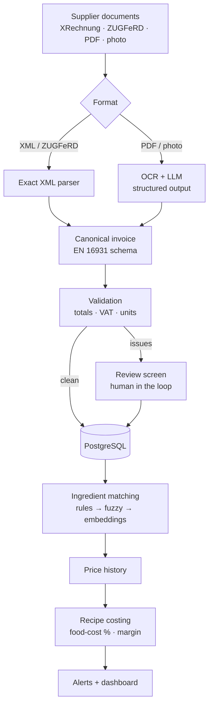

# Wareneinsatz-Pilot

[](https://github.com/Anant2580/wareneinsatz-pilot/actions/workflows/ci.yml)


**A food-cost copilot for restaurants.** It reads supplier invoices (XRechnung and ZUGFeRD e-invoices, PDFs and phone photos of paper receipts), turns them into ingredient prices and shows what each dish really costs, and which dishes lose margin when prices go up.

> 🚧 **Work in progress.** Step 1 of 9 is done: the canonical invoice schema, the database with migrations, tests and CI. See the [roadmap](#roadmap).

## Why

Small restaurants work out their food cost (*Wareneinsatz*) by hand, if at all: supplier invoices are typed into Excel or just filed away. Since January 2022, food, drinks, energy and staff have become more than 30 % more expensive in some cases, while menu prices rose 29.3 % ([DEHOGA Zahlenspiegel I/2026](https://www.dehoga-sachsen.de/fileadmin/user_upload/dehoga/Mitgliederbereich/DEHOGA-Zahlenspiegel_1._Quartal_2026.pdf)). A price jump on beef or frying oil quietly eats the margin of a dish.

E-invoices make part of this machine-readable: every German business has had to be able to receive XRechnung/ZUGFeRD since 2025, and sending them becomes mandatory in 2027 and 2028 ([IHK Magdeburg](https://www.ihk.de/magdeburg/recht/allgemeine-rechtsauskuenfte-1/steuerrecht/e-rechnung-6318984)). Invoices under €250 stay exempt, though, so cash & carry receipts and small suppliers will keep arriving on paper, as PDFs or as photos for years. A useful tool has to handle both.

## How it will work



## Roadmap

- [x] **Step 1 – Foundation:** canonical invoice schema (pydantic, EN 16931 field names), PostgreSQL schema with Alembic migrations, duplicate detection, tests against a real PostgreSQL, CI
- [ ] **Step 2 – E-invoices:** parse XRechnung (UBL and CII) and ZUGFeRD PDFs exactly
- [ ] **Step 3 – Validation:** check totals, VAT rates and units; uncertain invoices go to review
- [ ] **Step 4 – Evaluation set:** labelled documents and a script for field-level precision, recall and F1
- [ ] **Step 5 – PDFs and photos:** OCR + LLM extraction into the same schema, measured on the evaluation set
- [ ] **Step 6 – Ingredient matching** and price history per ingredient and supplier
- [ ] **Step 7 – Recipe costing and alerts:** food-cost %, gross margin, price jumps, monthly Wareneinsatz
- [ ] **Step 8 – API and UI:** FastAPI backend; Streamlit upload, review screen and dashboard
- [ ] **Step 9 – Deployment** on a cloud VM, and measured results in this README

## Design decisions so far

Details and reasons in [docs/decisions.md](docs/decisions.md).

- **One schema for every source.** XML parser and OCR + LLM both produce the same `InvoiceData` model, whose fields follow EN 16931 (the standard behind XRechnung and ZUGFeRD). Everything downstream is written once.
- **Store what is printed, calculate in code.** Amounts are kept as printed (net or gross); conversions and totals are computed in Python, never by the LLM.
- **Strict structure, lenient business rules.** Wrong types and unknown fields are rejected; well-formed but suspicious values are stored and flagged for review instead of being lost.
- **Exact money.** `NUMERIC` in PostgreSQL and `Decimal` in Python, with digit limits that match, so nothing is rounded silently.
- **The database enforces the rules.** Duplicate files (SHA-256) and duplicate invoices (supplier + invoice number) are caught by unique constraints and turned into clear errors.
- **Migrations are tested.** Every test run migrates an empty database up, checks that the models and migrations match, and migrates back down.

## Data model

Suppliers, documents (uploaded files), invoices, VAT breakdown and invoice lines exist today; ingredients, supplier products, recipes and alerts follow in steps 6 and 7. Diagram and formulas: [docs/schema.md](docs/schema.md).

## Run it locally

You need **Docker Desktop** and **[uv](https://docs.astral.sh/uv/)**.

```bash
cp .env.example .env                 # local settings
docker compose up -d --wait db       # PostgreSQL 16 on localhost:5433
uv sync                              # Python 3.12 + the exact versions from uv.lock
uv run alembic upgrade head          # create the tables
uv run pytest                        # unit tests + database tests
```

Database tests run against a separate database (`wareneinsatz_test`) and are skipped when `TEST_DATABASE_URL` is empty.

## Project structure

```
├── src/wareneinsatz/
│   ├── schemas.py        # canonical invoice schema (pydantic)
│   ├── models.py         # database tables (SQLAlchemy 2)
│   ├── repository.py     # storing invoices, duplicate detection
│   ├── config.py         # settings from environment variables / .env
│   └── db.py             # engine and sessions
├── migrations/           # Alembic migrations (0001: invoice tables)
├── tests/                # pytest: schema, repository, migrations
├── docs/                 # data model and design decisions
├── db/init/              # creates the test database in the local container
├── docker-compose.yml    # local PostgreSQL 16
└── .github/workflows/    # CI: lint, format check, tests against PostgreSQL 16
```

## Data

No real supplier or customer data is stored in this repository. Tests use synthetic invoices from fictional suppliers; later steps add official XRechnung/ZUGFeRD sample files (where the licence allows it) and generated invoices. Real receipts used for evaluation stay outside git (`data/private/` is ignored).

## Tech stack

Python 3.12 · pydantic 2 · SQLAlchemy 2 · Alembic · PostgreSQL 16 · Docker Compose · pytest · ruff · uv · GitHub Actions

## Author

**Anant Sharma** – M.Sc. Data & Knowledge Engineering student at Otto-von-Guericke-Universität Magdeburg, interested in data engineering, machine learning and AI.

Released under the [MIT License](LICENSE).
