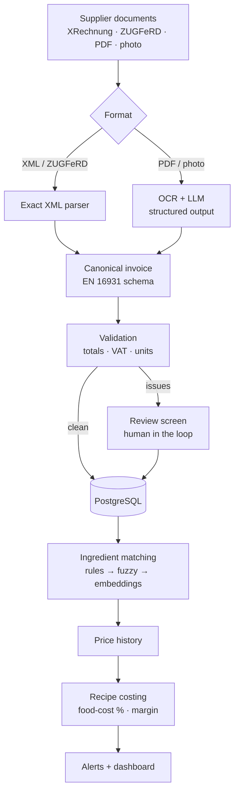

# Wareneinsatz-Pilot

[](https://github.com/Anant2580/wareneinsatz-pilot/actions/workflows/ci.yml)


**A food-cost copilot for restaurants.** It reads supplier invoices (XRechnung and ZUGFeRD e-invoices, PDFs and phone photos of paper receipts), turns them into ingredient prices and shows what each dish really costs, and which dishes lose margin when prices go up.

> 🚧 **Work in progress.** Steps 1–3 of 9 are done: XRechnung and ZUGFeRD invoices are read exactly, checked against business rules, and approved automatically or sent to review. See the [roadmap](#roadmap).

## Why

Small restaurants work out their food cost (*Wareneinsatz*) by hand, if at all: supplier invoices are typed into Excel or just filed away. Since January 2022, food, drinks, energy and staff have become more than 30 % more expensive in some cases, while menu prices rose 29.3 % ([DEHOGA Zahlenspiegel I/2026](https://www.dehoga-sachsen.de/fileadmin/user_upload/dehoga/Mitgliederbereich/DEHOGA-Zahlenspiegel_1._Quartal_2026.pdf)). A price jump on beef or frying oil quietly eats the margin of a dish.

E-invoices make part of this machine-readable: every German business has had to be able to receive XRechnung/ZUGFeRD since 2025, and sending them becomes mandatory in 2027 and 2028 ([IHK Magdeburg](https://www.ihk.de/magdeburg/recht/allgemeine-rechtsauskuenfte-1/steuerrecht/e-rechnung-6318984)). Invoices under €250 stay exempt, though, so cash & carry receipts and small suppliers will keep arriving on paper, as PDFs or as photos for years. A useful tool has to handle both.

## How it will work



## Roadmap

- [x] **Step 1 – Foundation:** canonical invoice schema (pydantic, EN 16931 field names), PostgreSQL schema with Alembic migrations, duplicate detection, tests against a real PostgreSQL, CI
- [x] **Step 2 – E-invoices:** XRechnung (UBL and CII) and ZUGFeRD/Factur-X PDFs read exactly, tested on the official KoSIT test invoices; command `wareneinsatz ingest`
- [x] **Step 3 – Validation:** totals, VAT, units, dates and supplier tax IDs checked; clean e-invoices approved automatically, the rest goes to review (`wareneinsatz review`)
- [ ] **Step 4 – Evaluation set:** labelled documents and a script for field-level precision, recall and F1
- [ ] **Step 5 – PDFs and photos:** OCR + LLM extraction into the same schema, measured on the evaluation set
- [ ] **Step 6 – Ingredient matching** and price history per ingredient and supplier
- [ ] **Step 7 – Recipe costing and alerts:** food-cost %, gross margin, price jumps, monthly Wareneinsatz
- [ ] **Step 8 – API and UI:** FastAPI backend; Streamlit upload, review screen and dashboard
- [ ] **Step 9 – Deployment** on a cloud VM, and measured results in this README

## Reading e-invoices (step 2)

```bash
uv run wareneinsatz ingest tests/samples/einvoices
```
```
needs OCR  musterfrisch_facturx_minimum.xml  XML has no invoice lines (profile: urn:factur-x.eu:1p0:minimum)
approved   musterfrisch_xrechnung_cii.xml  Musterfrisch Großhandel GmbH | invoice RE-2026-104233 | 7 lines | 302.66 EUR  (xml-cii, 3 ms)  [1 warning(s)]
duplicate  musterfrisch_xrechnung_ubl.xml  Invoice 'RE-2026-104233' from 'Musterfrisch Großhandel GmbH' is already stored

3 file(s): 1 approved, 0 review, 1 needs OCR, 1 duplicate, 0 failed
```

- **What is read exactly:** XRechnung in both syntaxes (UBL 2.1 and UN/CEFACT CII) and ZUGFeRD / Factur-X PDFs, whose CII XML is attached inside the PDF.
- **What waits for step 5:** PDFs without XML, photos and ZUGFeRD files in the MINIMUM and BASIC WL profiles, which carry only totals and no lines. They are stored with status `received`.
- **Duplicates:** the same file (SHA-256) or the same supplier's invoice number is not booked twice, even if one copy is XML and the other a ZUGFeRD PDF.
- **Nothing is lost:** broken files are stored with status `failed` and the reason; every original file is kept in a content-addressed store (`data/documents/`, not in git).
- **Tested on official data:** 22 pairs of official XRechnung test invoices from KoSIT (`tests/samples/kosit/`). Every file parses, its totals add up, and the UBL and CII versions of a case give the same invoice. Two findings from these files changed the schema (migration `0002`): unit prices can have 9 decimals, and correction invoices have negative totals.
- **Safe XML:** files come from outside, so XML is parsed with `defusedxml`; external entities (XXE) and entity bombs are refused, with tests for both.

## Checking invoices (step 3)

Every extracted invoice goes through business-rule checks. Most mirror the calculation rules of EN 16931 (BR-CO-*), so a valid e-invoice passes, and a misread or mistyped number does not.

| Check | Severity |
|---|---|
| Each line: quantity × price (÷ base quantity) + surcharges − discounts = line amount | error |
| Lines + charges − allowances = total without VAT; net + VAT = total with VAT | error |
| VAT per rate: rate × taxable amount = VAT amount; lines per rate = taxable amount; sum = VAT total | error |
| VAT rate exists and is German (19, 7, 0; 16 and 5 only from July to December 2020) | error |
| Invoice date present (needed for the price history) and not in the future | error |
| Unit recognised (UN/ECE codes; printed units like "Krt" or "St" are mapped) | error |
| Extraction confidence high enough (OCR + LLM, step 5) | error |
| VAT ID passes the official check-digit test; tax ID present above 250 EUR (§ 14 UStG) | warning |
| Same VAT ID filed under a different company name, or a different VAT ID for a known name | warning |
| EAN check digit, unlisted unit code, old invoice date, currency other than EUR | warning |

**Errors** send an invoice to review; **warnings** are kept for the review screen but don't block. Only invoices read exactly from XML can be approved automatically. Anything read by OCR + LLM will always be checked by a person first.

One of the official ZUGFeRD samples (`zugferd_2p1_EN16931_1_Teilrechnung.xml`) contains an arithmetic mistake:

```bash
uv run wareneinsatz review
```
```
#1     2018-06-05  Lieferant GmbH | invoice 471102 | 197.65 EUR
           error    Line 4: 20 × 2.77 = 55.40, but the line says 55.46
           warning  Invoice date 2018-06-05 is more than two years ago
           warning  VAT ID DE123456789 fails the official format or check-digit test

1 invoice(s) waiting for review
```

**Tested on official data:** all 44 KoSIT test invoices pass without a single error, so there are no false alarms on valid XRechnungen. In a wider set of 144 official ZUGFeRD and XRechnung samples, 4 were flagged. Two have genuine arithmetic mistakes in a line (20 × 2.77 printed as 55.46; 10,000 kWh × 0.052 printed as 52.00), and two are insurance invoices whose lines include insurance tax. Line discounts and surcharges found in the samples were added to the schema (migration `0003`), because a discount changes the real price of an ingredient.

## Design decisions so far

Details and reasons in [docs/decisions.md](docs/decisions.md).

- **One schema for every source.** XML parser and OCR + LLM both produce the same `InvoiceData` model, whose fields follow EN 16931 (the standard behind XRechnung and ZUGFeRD). Everything downstream is written once.
- **Store what is printed, calculate in code.** Amounts are kept as printed (net or gross); conversions and totals are computed in Python, never by the LLM.
- **Strict structure, lenient business rules.** Wrong types and unknown fields are rejected; well-formed but suspicious values are stored and flagged for review instead of being lost.
- **Exact money.** `NUMERIC` in PostgreSQL and `Decimal` in Python, with digit limits that match, so nothing is rounded silently.
- **The database enforces the rules.** Duplicate files (SHA-256) and duplicate invoices (supplier + invoice number) are caught by unique constraints and turned into clear errors.
- **Migrations are tested.** Every test run migrates an empty database up, checks that the models and migrations match, and migrates back down.

## Data model

Suppliers, documents (uploaded files), invoices, VAT breakdown and invoice lines exist today; ingredients, supplier products, recipes and alerts follow in steps 6 and 7. Diagram and formulas: [docs/schema.md](docs/schema.md).

## Run it locally

You need **Docker Desktop** and **[uv](https://docs.astral.sh/uv/)**.

```bash
cp .env.example .env                 # local settings
docker compose up -d --wait db       # PostgreSQL 16 on localhost:5433
uv sync                              # Python 3.12 + the exact versions from uv.lock
uv run alembic upgrade head          # create the tables
uv run pytest                        # unit tests + database tests
```

Database tests run against a separate database (`wareneinsatz_test`) and are skipped when `TEST_DATABASE_URL` is empty.

## Project structure

```
├── src/wareneinsatz/
│   ├── ingest/           # file type detection, UBL + CII parsers, ZUGFeRD, file store, pipeline
│   ├── validation.py     # business-rule checks (step 3)
│   ├── units.py          # UN/ECE unit codes, printed units, conversion to g / ml / piece
│   ├── cli.py            # `wareneinsatz ingest <files or folders>`, `wareneinsatz review`
│   ├── schemas.py        # canonical invoice schema (pydantic)
│   ├── models.py         # database tables (SQLAlchemy 2)
│   ├── repository.py     # storing invoices, duplicate detection
│   ├── config.py         # settings from environment variables / .env
│   └── db.py             # engine and sessions
├── migrations/           # Alembic migrations (0001 invoice tables, 0002/0003 findings from official samples)
├── tests/                # pytest; samples/ has synthetic and official KoSIT test invoices
├── docs/                 # data model and design decisions
├── db/init/              # creates the test database in the local container
├── docker-compose.yml    # local PostgreSQL 16
└── .github/workflows/    # CI: lint, format check, tests against PostgreSQL 16
```

## Data

No real supplier or customer data is stored in this repository. Tests use synthetic invoices from fictional suppliers and official XRechnung test invoices from KoSIT (Apache License 2.0, see `tests/samples/kosit/README.md`). Real receipts used for evaluation stay outside git (`data/private/` is ignored).

## Tech stack

Python 3.12 · pydantic 2 · SQLAlchemy 2 · Alembic · PostgreSQL 16 · defusedxml · pypdf · python-stdnum · Docker Compose · pytest · ruff · uv · GitHub Actions

## Author

**Anant Sharma** – M.Sc. Data & Knowledge Engineering student at Otto-von-Guericke-Universität Magdeburg, interested in data engineering, machine learning and AI.

Released under the [MIT License](LICENSE).
