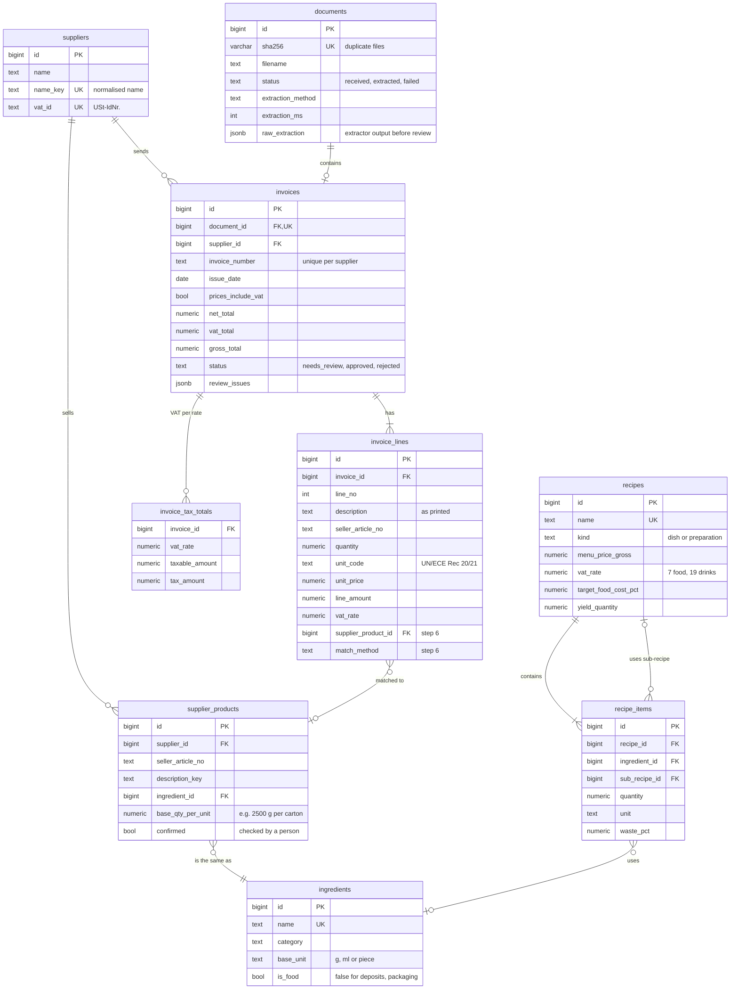

# Data model

PostgreSQL 16. Tables are added step by step through Alembic migrations; this page shows the
whole MVP model and which step adds each part. Steps 1 and 2 (migrations `0001`, `0002`) exist
today, the rest is the plan and may change as the project learns.

## Step 1: invoices (migrations `0001` and `0002`, exist)

| Table | Purpose |
|---|---|
| `suppliers` | Who sent the invoice. Found again by VAT ID, or by normalised name when a receipt has none. |
| `documents` | One row per uploaded file. SHA-256 rejects the same file twice; `raw_extraction` keeps the extractor's untouched output, so accuracy can be measured against the reviewed version. |
| `invoices` | Header and totals in EN 16931 terms. `(supplier_id, invoice_number)` is unique, so an invoice that arrives as XML and as PDF is booked once. An invoice can only be `approved` with a date. |
| `invoice_tax_totals` | VAT breakdown per rate (BG-23), used to check that totals add up. |
| `invoice_lines` | Lines exactly as printed: text, article number, quantity, unit, price, VAT rate. |

Migration `0002` (step 2) widened `unit_price` to NUMERIC(20,10) and allowed negative allowance and charge totals, after the official test invoices showed both.

## Step 6: matching and prices (planned, migration `0002`)

- `ingredients`: the kitchen's master list with one base unit each (g, ml or piece).
  Deposits (Pfand) and packaging are `is_food = false`, so they never count as food cost.
- `supplier_products`: what a supplier sells, mapped to an ingredient, with the pack size
  (e.g. "Pommes Frites TK, 4 x 2,5 kg" = 10,000 g per carton). Once a person confirms a mapping,
  the next invoice with the same article number matches automatically.
- `invoice_lines` gets `supplier_product_id`, `match_method` (article_no, rule, fuzzy, embedding,
  manual) and `match_score`, so matching accuracy can be measured per method.
- View `v_ingredient_prices`: net price per base unit (EUR per kg, l or piece) for every matched
  line of an approved invoice, by date and supplier. It is a view, so it can never go stale.

## Step 7: recipes and alerts (planned, migrations `0003`, `0004`)

- `recipes`: dishes (with menu price and VAT rate: 7 % for food in restaurants since 1 Jan 2026,
  19 % for drinks) and preparations such as a house sauce, which other recipes use.
- `recipe_items`: an ingredient or a sub-recipe (exactly one of the two, enforced by a CHECK),
  with quantity and waste percentage.
- `alerts`: price jumps, dishes above their food-cost target, cheaper supplier available.

## Calculations (planned)

| Value | Formula |
|---|---|
| Net line amount | `line_amount`, or `line_amount / (1 + vat_rate / 100)` when the document prints gross prices |
| Quantity in base units | `quantity` x unit factor (KGM = 1,000 g), or x `base_qty_per_unit` for cartons and crates |
| Price per base unit | net line amount / quantity in base units |
| Dish cost | sum over items of `quantity / (1 - waste_pct / 100)` x latest price per base unit |
| Food-cost % | dish cost / net menu price, net = `menu_price_gross / (1 + vat_rate / 100)` |
| Gross margin per dish | net menu price - dish cost |
| Monthly Wareneinsatz (MVP) | net purchases of food ingredients per month, credit notes subtracted |

The accounting definition of Wareneinsatz is opening stock + purchases - closing stock. Without
stock counts the MVP uses purchases; stock counts are a possible extension.
